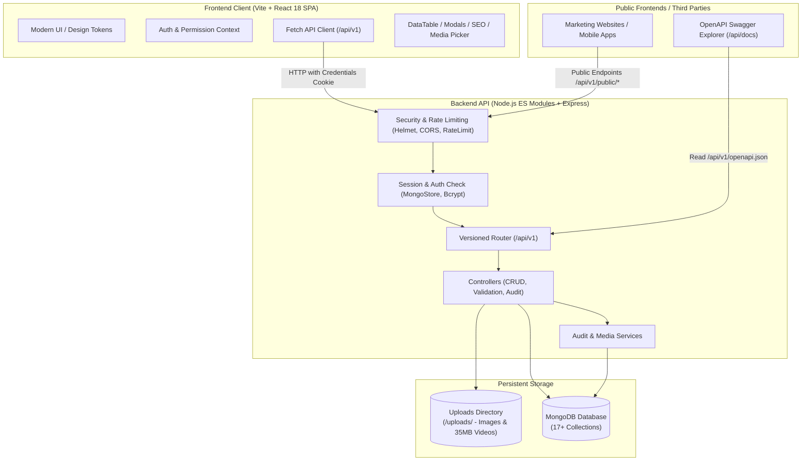
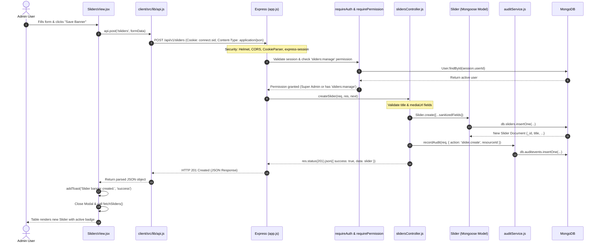

# Master Admin CMS — Complete System Architecture, Code Flow & Developer Manual

> **Document Type:** Master System Architecture, Code Flow Analysis & Developer Manual  
> **Target Audience:** Full-Stack Developers, Architects, Product Managers, and System Maintainers  
> **Platform Version:** 1.0.0 (MERN Modular Monolith)  
> **Date:** October 2026  
> **Status:** Comprehensive Engineering Reference  

---

## Table of Contents
1. [Executive System Overview](#1-executive-system-overview)
2. [Technology Stack & Architectural Principles](#2-technology-stack--architectural-principles)
3. [Full Repository Directory Map](#3-full-repository-directory-map)
4. [Master Feature Catalog & Operational Workflows](#4-master-feature-catalog--operational-workflows)
5. [End-to-End Code Flow Walkthrough (Concrete Example)](#5-end-to-end-code-flow-walkthrough-concrete-example)
6. [Developer Guide: Step-by-Step "How to Add a New Feature"](#6-developer-guide-step-by-step-how-to-add-a-new-feature)
7. [Security, Session Management & RBAC Governance](#7-security-session-management--rbac-governance)
8. [API Conventions & Error Standards](#8-api-conventions--error-standards)
9. [Operational Runbook (Setup, Seeding, Dev, Test & Docs)](#9-operational-runbook-setup-seeding-dev-test--docs)

---

## 1. Executive System Overview

The **Master Admin CMS** is an enterprise-grade, multi-domain Content Management System and Administration Suite engineered on the **MERN (MongoDB, Express, React, Node.js)** architecture. 

It is designed as a **Universal Content Platform**:
- **Independent Administration Shell:** A responsive, modern Single-Page Application (SPA) built with React 18, Vite, and custom CSS design tokens.
- **Headless Content API:** A versioned RESTful backend (`/api/v1`) that powers both the administrative back-office and any external consumer frontends (such as corporate marketing sites, mobile apps, or client portals).
- **Separation of Concerns:** Business data is stored in MongoDB, media files are stored on isolated storage with metadata tracking, and administrative sessions are stored securely in a Mongo session store with HTTP-only cookies.



---

## 2. Technology Stack & Architectural Principles

### 2.1 Technology Stack Summary

| Layer | Technology | Version | Purpose & Rationale |
| :--- | :--- | :--- | :--- |
| **Backend Runtime** | Node.js | v18+ | Native ES Module syntax (`"type": "module"`), fast asynchronous I/O. |
| **Web Framework** | Express | ^4.21.2 | Minimalist, stable HTTP routing engine with flexible middleware chains. |
| **Database** | MongoDB + Mongoose | ^8.9.5 | Document database with schema enforcement, indexes, and validation. |
| **Session & Auth** | express-session + connect-mongo | ^1.18.1 / ^5.1.0 | Server-side stateful sessions, HTTP-only secure cookie, zero JWT token leakage risks. |
| **Security Layer** | Helmet, CORS, express-rate-limit | ^8.0.0 / ^7.5.0 | Header hardening, origin isolation, protection against brute-force attacks. |
| **Password Hashing**| bcryptjs | ^2.4.3 | Salted one-way hashing for user credentials. |
| **File Handling** | Multer | ^1.4.5 | Multipart upload processing, MIME type validation, 35MB video payload support. |
| **Frontend Framework**| React | ^18.3.1 | Declarative component UI with state hooks and context. |
| **Build Tooling** | Vite | ^6.0.7 | Instant Hot Module Replacement (HMR) and optimized ES bundle generation. |
| **Styling & Theme** | Vanilla CSS (CSS Variables) | Modern CSS | Complete control over design tokens, light/dark canvas, zero build overhead. |
| **Icons** | Lucide React | ^0.469.0 | Lightweight, crisp vector iconography. |
| **Documentation** | OpenAPI 3.0 + Swagger UI | v5 | Machine-readable API spec and interactive playground at `/api/docs`. |

### 2.2 Core Architectural Principles

1. **Security by Design:** Every administrative endpoint requires an active session (`requireAuth`) and role-based permissions (`requirePermission`).
2. **Predictable REST Standard:** Strict HTTP method mappings (`GET`, `POST`, `PUT`, `DELETE`) with unified JSON envelopes (`{ success: true, data: ... }` vs `{ success: false, error: ... }`).
3. **Auditability:** Every administrative modification (create, update, delete, status toggle) triggers an immutable audit log entry capturing actor, IP address, timestamp, and entity diff.
4. **Resilient Public Facade:** Public endpoints (`/api/v1/public/*`) never leak sensitive database fields, user passwords, internal IDs, or draft items.
5. **No Blind State Dependencies:** Modals and tables operate with clean separation: data tables handle filtering and pagination, while editors receive explicit state objects.

---

## 3. Full Repository Directory Map

```
Master AdminPannel/
├── package.json                   # Root workspace scripts (server, client, seed, test)
├── ARCHITECTURE.md                # System design & blueprint documentation
├── API_CONVENTIONS.md             # API routing, error, and pagination rules
├── FEATURE_MATRIX.md              # Detailed module delivery status
├── MASTER_INSTRUCTION_PROMPT.md   # Architectural principles & engineering prompt
├── README.md                      # Quickstart guide
├── client/                        # Frontend React + Vite Application
│   ├── index.html                 # Single-page HTML shell
│   ├── package.json               # Client dependencies (React, Vite, Lucide)
│   ├── vite.config.js             # Vite config with /api proxy to localhost:5000
│   └── src/
│       ├── main.jsx               # React DOM entrypoint
│       ├── App.jsx                # Session bootstrap & authenticated view router
│       ├── index.css              # Universal CSS variables, layout, components
│       ├── context/
│       │   └── AuthContext.jsx    # Session state, login/logout, toasts, permissions
│       ├── lib/
│       │   └── api.js             # Central fetch client (credentials: 'include')
│       ├── components/
│       │   ├── layout/            # Shell components
│       │   │   ├── AppLayout.jsx  # Main container & tab router
│       │   │   ├── Header.jsx     # Navigation bar, user menu, current route
│       │   │   └── Sidebar.jsx    # Collapsible sidebar with RBAC filtering
│       │   ├── ui/                # Reusable UI widgets
│       │   │   ├── DataTable.jsx  # Search, filter, pagination, sorting table
│       │   │   ├── Modal.jsx      # Generic accessible modal dialog
│       │   │   ├── ConfirmDialog.jsx # Destructive action confirmation
│       │   │   └── StatusBadge.jsx# Semantic colored status pills
│       │   └── common/            # Cross-cutting feature widgets
│       │       ├── MediaPickerModal.jsx # Unified image/video asset selector
│       │       ├── ProfileModal.jsx     # Current user profile & password editor
│       │       └── SEOPanel.jsx         # Meta tags, canonical, Google snippet preview
│       └── features/              # Feature domain views (19 distinct modules)
│           ├── audit/             # Audit logs viewer & filters
│           ├── auth/              # Login screen & recovery
│           ├── blogs/             # Article editor, categories, tags, SEO
│           ├── contacts/          # Inbound message inbox, detail modal, CSV export
│           ├── dashboard/         # Real-time metrics, status counts, recent logs
│           ├── faqs/              # FAQ questions, categories, reordering
│           ├── media/             # Media library grid, upload zone, asset details
│           ├── navigation/        # Header & footer menus, parent-child links
│           ├── pages/             # Page builder, block manager, slug & SEO
│           ├── partners/          # Partner & client logos and websites
│           ├── popups/            # Notification banners, modals, display rules
│           ├── seo/               # Global SEO, robots.txt, 301/302 redirects
│           ├── services/          # Services catalog, icons, pricing, features
│           ├── settings/          # Branding, color palette, company contacts
│           ├── sliders/           # Hero sliders, video banners, CTA buttons
│           ├── system/            # Node memory, MongoDB telemetry, uptime
│           ├── team/              # Team portraits, bios, social channels
│           ├── testimonials/      # Reviews, 5-star ratings, quotes
│           └── users/             # User accounts, RBAC roles, permission matrix
└── server/                        # Backend Node.js Express REST API
    ├── package.json               # Server dependencies & scripts
    ├── uploads/                   # Staged upload media directory
    ├── tests/
    │   └── api.test.js            # Node native integration test suite
    └── src/
        ├── server.js              # HTTP server & database listener
        ├── app.js                 # Express application, security middlewares, routes
        ├── config/
        │   ├── db.js              # Mongoose MongoDB connection pooling
        │   └── session.js         # MongoStore session configuration
        ├── docs/
        │   └── openapi.json       # Complete OpenAPI 3.0 specification
        ├── middleware/
        │   ├── auth.js            # requireAuth & requirePermission middleware
        │   ├── errorHandler.js    # Standard error formatter
        │   ├── rateLimiter.js     # Auth, API, and Public rate limiting
        │   └── upload.js          # Multer storage configuration (35MB video)
        ├── models/                # 17 Mongoose Data Schemas
        │   ├── AuditEvent.js      # Immutable system activity log
        │   ├── BlogPost.js        # Articles, categories, tags, SEO
        │   ├── ContactSubmission.js# Inbound inquiries & status tracking
        │   ├── FAQ.js             # Categorized FAQs
        │   ├── MediaAsset.js      # File storage metadata & dimensions
        │   ├── NavigationMenu.js  # Menu tree (header, footer, custom)
        │   ├── Page.js            # Page documents & dynamic content blocks
        │   ├── Partner.js         # Brand logos & client links
        │   ├── Popup.js           # Modal & banner announcements
        │   ├── Redirect.js        # 301/302 SEO URL redirection engine
        │   ├── Role.js            # Role definitions & permission arrays
        │   ├── Service.js         # Service offerings, features, SEO
        │   ├── SiteSettings.js    # Global branding, colors, socials, meta
        │   ├── Slider.js          # Hero slides, video loops, call-to-actions
        │   ├── TeamMember.js      # Staff directory & social URLs
        │   ├── Testimonial.js     # Customer quotes, ratings, avatars
        │   └── User.js            # User accounts, salted hashes, roles
        ├── routes/                # Express Route Declarations
        │   ├── index.js           # Central route dispatcher (/api/v1/*)
        │   ├── publicRoutes.js    # Public, unauthenticated endpoints (/api/v1/public/*)
        │   └── [feature]Routes.js # 18 authenticated feature route files
        ├── controllers/           # Business logic & database operations
        │   └── [feature]Controller.js # 19 dedicated controllers
        ├── services/
        │   └── auditService.js    # Audit log writer
        └── utils/
            └── seed.js            # Default database bootstrapper
```

---

## 4. Master Feature Catalog & Operational Workflows

Below is the complete inventory of all 19 functional domains implemented in Master Admin CMS:

### 4.1 Authentication & Profile (`/api/v1/auth`)
- **Operations:**
  - `POST /login`: Authenticates email and password with bcrypt, establishes a secure session cookie (`connect.sid`), audits successful sign-in.
  - `POST /logout`: Destroys server-side session in MongoDB and clears cookie.
  - `GET /me`: Returns currently logged-in user profile with computed role permissions.
  - `PUT /me`: Updates display name, phone, or password with existing password confirmation.

### 4.2 Dashboard Analytics (`/api/v1/dashboard`)
- **Operations:**
  - `GET /`: Aggregates real collection counts across Pages, Blogs, Services, Media, Users, and Inquiries. Provides recent activity audit feeds and inbox breakdown without calculating dummy values.

### 4.3 Site Settings & Branding (`/api/v1/settings` & `/api/v1/public/settings`)
- **Operations:**
  - Manages primary/secondary brand colors, typography (`fontFamily`), site title, tagline, logo URL, favicon URL, social profiles (Twitter, LinkedIn, GitHub, Facebook), contact phone/email/address, and copyright text.
  - Public route returns a sanitized object hiding administrative timestamps and system keys.

### 4.4 Pages & Dynamic Block Builder (`/api/v1/pages` & `/api/v1/public/pages/:slug`)
- **Operations:**
  - Complete CMS page creation with custom slugs, page title, status (`draft`, `published`, `archived`), and embedded block schemas (Hero, Rich Text, Feature Grid, Call-to-Action).
  - Includes integrated SEO fields (meta title, description, keywords, OpenGraph card image, canonical URL).
  - Public endpoint verifies publication state before serving to consumer sites.

### 4.5 Services Management (`/api/v1/services` & `/api/v1/public/services`)
- **Operations:**
  - Manage services offerings with title, slug, category, short excerpt, rich content, feature lists, pricing/CTA link, and custom icons.
  - Supports ordering and soft-deletion protection.

### 4.6 Blog & Articles Engine (`/api/v1/blogs` & `/api/v1/public/blogs`)
- **Operations:**
  - Long-form article publishing with Markdown/rich-text content, featured image selection from the Media Library, estimated reading time, author attribution, tags, categories, and SEO parameters.
  - Public endpoints provide paginated listings and slug-based retrieval.

### 4.7 Hero Sliders & Video Banners (`/api/v1/sliders` & `/api/v1/public/sliders`)
- **Operations:**
  - Supports both high-resolution images and short video banners (up to 35MB).
  - Configurable headline, subtitle, primary CTA label, CTA URL destination, display order, and date scheduling (start and expiration dates).

### 4.8 Testimonials & Client Reviews (`/api/v1/testimonials` & `/api/v1/public/testimonials`)
- **Operations:**
  - Customer review management with author name, company name, position, star rating (1–5), quotation body, and avatar image.

### 4.9 Team Members Directory (`/api/v1/team` & `/api/v1/public/team`)
- **Operations:**
  - Staff profiles including portrait photos, job titles, department, short bio, social handles (LinkedIn, Twitter, GitHub), and sorting sequence.

### 4.10 Partners & Clients (`/api/v1/partners` & `/api/v1/public/partners`)
- **Operations:**
  - Brand association logos, company names, external website links, and partnership tiers.

### 4.11 FAQs (`/api/v1/faqs` & `/api/v1/public/faqs`)
- **Operations:**
  - Frequently Asked Questions categorized by topic (General, Billing, Technical, Services) with accordion display order and publishing toggle.

### 4.12 Popups & Announcements (`/api/v1/popups` & `/api/v1/public/popups/active`)
- **Operations:**
  - Marketing popups, newsletter opt-in prompts, and urgent alert banners.
  - Display triggers include `immediate`, `delay` (seconds), `scroll` (percentage), or `exit-intent`.
  - Public route `/popups/active` safely returns the single currently active popup for public frontends.

### 4.13 Media Library & Uploads (`/api/v1/media`)
- **Operations:**
  - Central file repository supporting JPEG, PNG, WebP, SVG, and MP4/WebM video files up to 35MB.
  - Automatically calculates file size, MIME type, dimensions, and saves metadata in MongoDB.
  - Provides instant insertion into any content form via `MediaPickerModal`.

### 4.14 Contact Inquiries & CRM (`/api/v1/contacts` & `POST /api/v1/public/contact`)
- **Operations:**
  - Receives leads from public frontend forms with rate-limiting and validation.
  - Admin inbox with status workflow: `new` -> `read` -> `replied` -> `archived`.
  - Internal operator notes and one-click **CSV export** for sales teams.

### 4.15 SEO & Redirects Suite (`/api/v1/seo`)
- **Operations:**
  - Manage global meta tags, OpenGraph cards, schema markup configurations, and `robots.txt`.
  - **Redirects Engine:** Create HTTP `301 (Permanent)` and `302 (Temporary)` redirects to prevent broken links during website migrations.
  - **Dynamic Sitemap:** Generates compliant XML sitemaps at `/api/v1/public/sitemap.xml` aggregating all published pages, blogs, and services automatically.

### 4.16 Navigation Menus (`/api/v1/navigation` & `/api/v1/public/navigation`)
- **Operations:**
  - Manage Header, Footer, and Mobile navigation structures with nested hierarchy, internal links, external URLs, target flags (`_blank`), and ordering.

### 4.17 Users & RBAC Governance (`/api/v1/users`)
- **Operations:**
  - Create, edit, and deactivate user accounts.
  - Assign roles (`superadmin`, `admin`, `editor`, `viewer`).
  - View permissions assigned to each role. Super Admins have unconditional `*` access.

### 4.18 Audit Logs (`/api/v1/audit`)
- **Operations:**
  - Read-only historical ledger documenting every mutating action across the system.
  - Filterable by date range, action type (`page.create`, `user.update`, etc.), and user email.

### 4.19 System Diagnostics (`/api/v1/system`)
- **Operations:**
  - Real-time server telemetry: Node runtime memory usage (RSS, heap total, heap used), server uptime, Node.js version, platform OS, and MongoDB connection state.

---

## 5. End-to-End Code Flow Walkthrough (Concrete Example)

To illustrate how data and control travel between the client, network, server, database, and audit log, here is the complete trace of a real operation: **Creating a new Hero Slider**.



### Detailed Breakdown of the 8 Steps:

1. **Client Event in UI (`client/src/features/sliders/SlidersView.jsx`):**
   - The user opens the modal, enters the title, picks an image via `MediaPickerModal`, and clicks "Save Banner".
   - `handleSave(e)` is invoked. It sets `saving = true` and invokes `api.post('/sliders', formData)`.
2. **Network Request via Client Wrapper (`client/src/lib/api.js`):**
   - `api.post` serializes the payload to JSON and sends a `fetch` request to `/api/v1/sliders`.
   - `credentials: 'include'` is automatically passed, which instructs the browser to attach the HTTP-only `connect.sid` cookie.
3. **Server Middlewares (`server/src/app.js`):**
   - Helmet verifies security headers.
   - CORS checks the `Origin` header.
   - `express.json()` parses the request body.
   - `cookieParser()` and `configureSession()` parse the cookie and load the user session from the MongoDB `sessions` collection.
4. **Route Dispatching & RBAC Authorization (`server/src/routes/slidersRoutes.js`):**
   - The route `router.post('/', requireAuth, requirePermission('sliders:manage'), createSlider)` triggers.
   - `requireAuth` ensures `req.session.userId` exists and loads `req.user`.
   - `requirePermission('sliders:manage')` checks if `req.user.role` is `superadmin`/`admin` or if the role possesses the `'sliders:manage'` permission string.
5. **Controller Processing (`server/src/controllers/slidersController.js`):**
   - `createSlider` validates that `title` and `mediaUrl` are present.
   - If validation fails, it immediately returns `res.status(400).json({ success: false, error: { code: 'VALIDATION_ERROR', message: '...' } })`.
6. **Mongoose Document Persistence (`server/src/models/Slider.js`):**
   - `Slider.create(...)` validates types against the Mongoose schema and inserts the document into the `sliders` collection in MongoDB.
7. **Audit Trail Recording (`server/src/services/auditService.js`):**
   - `recordAudit(req, { action: 'slider.create', resourceType: 'Slider', resourceId: slider._id, details: { title } })` captures the user ID, user email, client IP address, and user-agent string into the `auditevents` collection.
8. **Client UI Reactivity:**
   - The server returns `{ success: true, data: slider }` with HTTP status `201`.
   - The frontend catches this, fires `addToast('Slider banner created.', 'success')`, closes the modal, and calls `fetchSliders()` to re-fetch the table data.

---

## 6. Developer Guide: Step-by-Step "How to Add a New Feature"

Follow this exact blueprint to add a new module to both the backend and frontend in minutes. For this walkthrough, we will implement an example module: **"Case Studies"** (`CaseStudy`).

### Step 1: Create the Mongoose Model
Create `server/src/models/CaseStudy.js`:
```javascript
import mongoose from 'mongoose';

const caseStudySchema = new mongoose.Schema(
  {
    title: { type: String, required: true, trim: true },
    slug: { type: String, required: true, unique: true, lowercase: true, trim: true },
    clientName: { type: String, default: '', trim: true },
    summary: { type: String, default: '', trim: true },
    challenge: { type: String, default: '' },
    solution: { type: String, default: '' },
    results: { type: String, default: '' },
    coverImage: { type: String, default: '' },
    order: { type: Number, default: 0, index: true },
    status: { type: String, enum: ['draft', 'published'], default: 'draft', index: true },
  },
  { timestamps: true }
);

export const CaseStudy = mongoose.model('CaseStudy', caseStudySchema);
```

### Step 2: Create the Controller
Create `server/src/controllers/caseStudiesController.js`:
```javascript
import { CaseStudy } from '../models/CaseStudy.js';
import { recordAudit } from '../services/auditService.js';

export async function listCaseStudies(req, res, next) {
  try {
    const filter = {};
    if (req.query.status && req.query.status !== 'all') {
      filter.status = req.query.status;
    }
    const items = await CaseStudy.find(filter).sort({ order: 1, createdAt: -1 });
    res.status(200).json({ success: true, data: items });
  } catch (error) {
    next(error);
  }
}

export async function createCaseStudy(req, res, next) {
  try {
    const { title, slug, clientName, summary, coverImage, status, order } = req.body;
    if (!title || !slug) {
      return res.status(400).json({
        success: false,
        error: { code: 'VALIDATION_ERROR', message: 'Title and slug are required.' },
      });
    }

    const item = await CaseStudy.create({
      title: title.trim(),
      slug: slug.trim().toLowerCase(),
      clientName: clientName || '',
      summary: summary || '',
      coverImage: coverImage || '',
      status: status || 'draft',
      order: order || 0,
    });

    await recordAudit(req, {
      action: 'casestudy.create',
      resourceType: 'CaseStudy',
      resourceId: item._id,
      details: { title: item.title },
    });

    res.status(201).json({ success: true, data: item });
  } catch (error) {
    next(error);
  }
}

export async function updateCaseStudy(req, res, next) {
  try {
    const item = await CaseStudy.findById(req.params.id);
    if (!item) {
      return res.status(404).json({
        success: false,
        error: { code: 'NOT_FOUND', message: 'Case study not found.' },
      });
    }

    Object.assign(item, req.body);
    await item.save();

    await recordAudit(req, {
      action: 'casestudy.update',
      resourceType: 'CaseStudy',
      resourceId: item._id,
      details: { title: item.title },
    });

    res.status(200).json({ success: true, data: item });
  } catch (error) {
    next(error);
  }
}

export async function deleteCaseStudy(req, res, next) {
  try {
    const item = await CaseStudy.findByIdAndDelete(req.params.id);
    if (!item) {
      return res.status(404).json({
        success: false,
        error: { code: 'NOT_FOUND', message: 'Case study not found.' },
      });
    }

    await recordAudit(req, {
      action: 'casestudy.delete',
      resourceType: 'CaseStudy',
      resourceId: item._id,
      details: { title: item.title },
    });

    res.status(200).json({ success: true, message: 'Case study deleted successfully.' });
  } catch (error) {
    next(error);
  }
}
```

### Step 3: Define Routes with RBAC Middleware
Create `server/src/routes/caseStudiesRoutes.js`:
```javascript
import express from 'express';
import {
  listCaseStudies,
  createCaseStudy,
  updateCaseStudy,
  deleteCaseStudy,
} from '../controllers/caseStudiesController.js';
import { requireAuth, requirePermission } from '../middleware/auth.js';

const router = express.Router();

router.get('/', requireAuth, requirePermission('casestudies:read'), listCaseStudies);
router.post('/', requireAuth, requirePermission('casestudies:manage'), createCaseStudy);
router.put('/:id', requireAuth, requirePermission('casestudies:manage'), updateCaseStudy);
router.delete('/:id', requireAuth, requirePermission('casestudies:manage'), deleteCaseStudy);

export default router;
```

### Step 4: Mount the Route in `server/src/routes/index.js`
Open `server/src/routes/index.js` and add:
```javascript
import caseStudiesRoutes from './caseStudiesRoutes.js';
// ...
router.use('/case-studies', caseStudiesRoutes);
```

### Step 5: (Optional) Expose Public Consumer API
In `server/src/routes/publicRoutes.js`, add:
```javascript
import { CaseStudy } from '../models/CaseStudy.js';

router.get('/case-studies', async (req, res, next) => {
  try {
    const items = await CaseStudy.find({ status: 'published' }).sort({ order: 1 });
    res.status(200).json({ success: true, data: items });
  } catch (err) {
    next(err);
  }
});
```

### Step 6: Create the Frontend React View
Create `client/src/features/casestudies/CaseStudiesView.jsx`:
```jsx
import React, { useState, useEffect } from 'react';
import { DataTable } from '../../components/ui/DataTable.jsx';
import { Modal } from '../../components/ui/Modal.jsx';
import { ConfirmDialog } from '../../components/ui/ConfirmDialog.jsx';
import { StatusBadge } from '../../components/ui/StatusBadge.jsx';
import { MediaPickerModal } from '../../components/common/MediaPickerModal.jsx';
import { api } from '../../lib/api.js';
import { useAuth } from '../../context/AuthContext.jsx';
import { Plus, Edit, Trash2 } from 'lucide-react';

export function CaseStudiesView() {
  const { addToast } = useAuth();
  const [items, setItems] = useState([]);
  const [loading, setLoading] = useState(true);
  const [isEditorOpen, setIsEditorOpen] = useState(false);
  const [editingItem, setEditingItem] = useState(null);
  const [deleteId, setDeleteId] = useState(null);
  const [isMediaPickerOpen, setIsMediaPickerOpen] = useState(false);

  const [formData, setFormData] = useState({
    title: '',
    slug: '',
    clientName: '',
    summary: '',
    coverImage: '',
    status: 'draft',
    order: 0,
  });

  const fetchItems = async () => {
    try {
      setLoading(true);
      const res = await api.get('/case-studies');
      if (res.success) setItems(res.data);
    } catch (err) {
      addToast(err.message, 'error');
    } finally {
      setLoading(false);
    }
  };

  useEffect(() => {
    fetchItems();
  }, []);

  const handleSave = async (e) => {
    e.preventDefault();
    try {
      if (editingItem) {
        await api.put(`/case-studies/${editingItem._id}`, formData);
        addToast('Case study updated.', 'success');
      } else {
        await api.post('/case-studies', formData);
        addToast('Case study created.', 'success');
      }
      setIsEditorOpen(false);
      fetchItems();
    } catch (err) {
      addToast(err.message, 'error');
    }
  };

  const columns = [
    {
      header: 'Title',
      accessor: 'title',
      cell: (row) => (
        <div>
          <div style={{ fontWeight: 600 }}>{row.title}</div>
          <div style={{ fontSize: '12px', color: 'var(--text-muted)' }}>/{row.slug}</div>
        </div>
      ),
    },
    { header: 'Client', accessor: 'clientName' },
    {
      header: 'Status',
      accessor: 'status',
      cell: (row) => <StatusBadge status={row.status} />,
    },
    {
      header: 'Actions',
      cell: (row) => (
        <div style={{ display: 'flex', gap: '8px' }}>
          <button
            className="btn-icon"
            onClick={() => {
              setEditingItem(row);
              setFormData(row);
              setIsEditorOpen(true);
            }}
          >
            <Edit size={16} />
          </button>
          <button className="btn-icon" onClick={() => setDeleteId(row._id)}>
            <Trash2 size={16} style={{ color: 'var(--danger)' }} />
          </button>
        </div>
      ),
    },
  ];

  return (
    <div className="view-container">
      <div className="view-header">
        <div>
          <h1 className="view-title">Case Studies</h1>
          <p className="view-subtitle">Manage customer success stories and showcase portfolios.</p>
        </div>
        <button
          className="btn btn-primary"
          onClick={() => {
            setEditingItem(null);
            setFormData({ title: '', slug: '', clientName: '', summary: '', coverImage: '', status: 'draft', order: 0 });
            setIsEditorOpen(true);
          }}
        >
          <Plus size={16} /> Add Case Study
        </button>
      </div>

      <DataTable data={items} columns={columns} loading={loading} />

      <Modal
        isOpen={isEditorOpen}
        onClose={() => setIsEditorOpen(false)}
        title={editingItem ? 'Edit Case Study' : 'Create Case Study'}
      >
        <form onSubmit={handleSave} className="form-grid">
          <div className="form-group">
            <label className="form-label">Title *</label>
            <input
              className="form-input"
              value={formData.title}
              onChange={(e) => setFormData({ ...formData, title: e.target.value })}
              required
            />
          </div>
          <div className="form-group">
            <label className="form-label">Slug *</label>
            <input
              className="form-input"
              value={formData.slug}
              onChange={(e) => setFormData({ ...formData, slug: e.target.value })}
              required
            />
          </div>
          <div className="form-group">
            <label className="form-label">Client Name</label>
            <input
              className="form-input"
              value={formData.clientName}
              onChange={(e) => setFormData({ ...formData, clientName: e.target.value })}
            />
          </div>
          <div className="form-group">
            <label className="form-label">Status</label>
            <select
              className="form-select"
              value={formData.status}
              onChange={(e) => setFormData({ ...formData, status: e.target.value })}
            >
              <option value="draft">Draft</option>
              <option value="published">Published</option>
            </select>
          </div>
          <button type="submit" className="btn btn-primary" style={{ marginTop: '16px' }}>
            Save Case Study
          </button>
        </form>
      </Modal>

      <ConfirmDialog
        isOpen={Boolean(deleteId)}
        onClose={() => setDeleteId(null)}
        onConfirm={async () => {
          await api.delete(`/case-studies/${deleteId}`);
          setDeleteId(null);
          addToast('Case study deleted.', 'success');
          fetchItems();
        }}
        title="Delete Case Study"
        message="Are you sure you want to permanently delete this case study?"
      />
    </div>
  );
}
```

### Step 7: Mount View in `AppLayout.jsx` and Sidebar
1. In `client/src/components/layout/AppLayout.jsx`:
   - Import `CaseStudiesView`.
   - Add `case 'case-studies': return <CaseStudiesView />;` to `renderActiveView()`.
2. In `client/src/components/layout/Sidebar.jsx`:
   - Add `{ key: 'case-studies', label: 'Case Studies', icon: Briefcase, perm: 'casestudies:read' }` to the `Content Engine` navigation group.

---

## 7. Security, Session Management & RBAC Governance

### 7.1 Stateful Server Sessions vs. Stateless JWTs
The Master Admin CMS deliberately utilizes **Stateful Sessions** stored in MongoDB via `connect-mongo` instead of stateless JWTs stored in browser `localStorage`:
- **Immediate Revocation:** If an administrator account is compromised or deactivated, destroying their session in MongoDB immediately blocks all further requests.
- **Zero XSS Token Theft:** Session IDs exist only within an `HttpOnly`, `SameSite=Lax` browser cookie. Client JavaScript cannot read the session cookie.
- **Auto-Extending Lifespan:** The session remains valid for 7 days of active usage, automatically rolling over.

### 7.2 Role-Based Access Control (RBAC) Matrix

| Permission Key | Super Admin | Administrator | Content Editor | Auditor / Viewer |
| :--- | :---: | :---: | :---: | :---: |
| `*` (Full System Override) |  Yes | No | No | No |
| `dashboard:read` |  Yes |  Yes |  Yes |  Yes |
| `settings:update` |  Yes |  Yes | No | No |
| `pages:publish` / `blogs:publish` |  Yes |  Yes |  Yes | No |
| `media:create` / `upload` |  Yes |  Yes |  Yes | No |
| `media:delete` |  Yes |  Yes | No | No |
| `users:manage` / `roles:manage` |  Yes |  Yes | No | No |
| `contacts:export` |  Yes |  Yes | No | No |
| `audit:read` |  Yes |  Yes | No |  Yes |
| `system:read` (Diagnostics) |  Yes |  Yes | No | No |

---

## 8. API Conventions & Error Standards

All REST API endpoints adhere strictly to these envelope structures:

### Success Response Envelope (HTTP 200 / 201)
```json
{
  "success": true,
  "data": {
    "_id": "671cc81...",
    "title": "Welcome to Apex",
    "status": "active"
  }
}
```

### Error Response Envelope (HTTP 4xx / 5xx)
```json
{
  "success": false,
  "error": {
    "code": "VALIDATION_ERROR",
    "message": "Slider title and media URL are required.",
    "details": null
  }
}
```

### Common Error Codes:
- `UNAUTHORIZED` (401): Missing or expired session cookie.
- `FORBIDDEN` (403): User lacks the required permission key.
- `VALIDATION_ERROR` (400): Required schema fields are missing or malformed.
- `NOT_FOUND` (404): Resource ID or route does not exist.
- `RATE_LIMIT_EXCEEDED` (429): Client exceeded request quotas.

---

## 9. Operational Runbook (Setup, Seeding, Dev, Test & Docs)

### 9.1 Environment Configuration (`server/.env`)
```env
PORT=5000
NODE_ENV=development
MONGODB_URI=mongodb://127.0.0.1:27017/master_admin_cms
SESSION_SECRET=super_secret_session_key_replace_in_production
CLIENT_URL=http://localhost:5173
UPLOAD_DIR=uploads
MAX_FILE_SIZE_MB=35
```

### 9.2 Initial Database Seeding
To initialize system roles, seed default categories, populate global site settings, and create the default Super Admin:
```bash
npm run seed
```
**Default Super Admin Credentials:**
- **Email:** `admin@mastercms.com`
- **Password:** `Admin@123456`

### 9.3 Launching Development Servers
From the root workspace folder:
```bash
# Terminal 1: Backend API (runs on http://localhost:5000 with --watch)
npm run server:dev

# Terminal 2: Frontend Client (runs on http://localhost:5173 with Vite HMR)
npm run client
```

### 9.4 Running the Test Suite
The backend features an automated integration test suite written with the native Node.js test runner (`node:test`) and `supertest`:
```bash
npm run test:server
```
The test suite validates:
1. Public health check (`/api/health`).
2. Public safe settings (ensures zero password or internal ID leakage).
3. Session protection (blocks unauthorized access to `/api/v1/dashboard`).
4. Rate limiting and brute-force mitigation.
5. Successful login & session cookie issuance.
6. Authenticated session validation via `/api/v1/auth/me`.

### 9.5 Interactive API Documentation
Open your browser to:
[http://localhost:5000/api/docs](http://localhost:5000/api/docs)
This serves a live Swagger UI powered by OpenAPI 3.0 (`server/src/docs/openapi.json`), allowing instant endpoint testing and schema inspection.

---

*Document compiled and verified for Master Admin CMS. For further updates or schema additions, follow the Step-by-Step Developer Guide in Section 6.*
