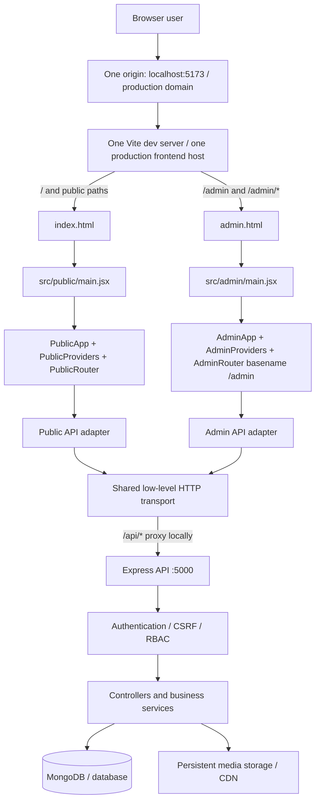
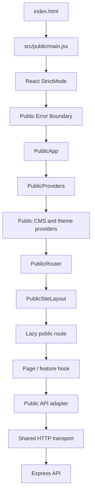
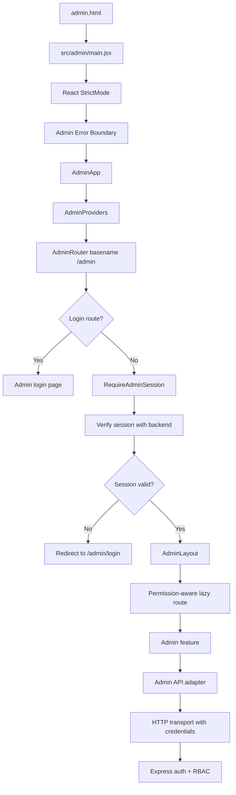
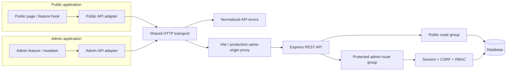
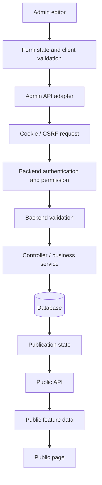
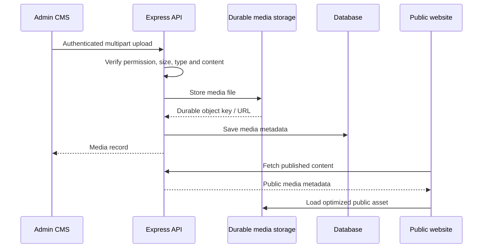
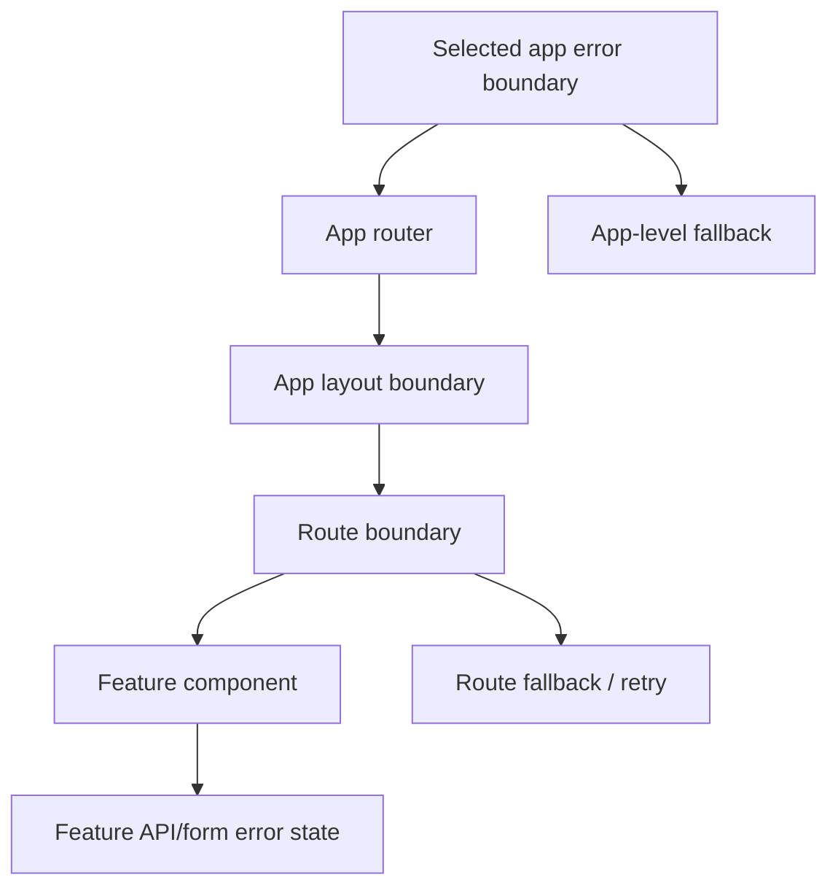

Project: KBR Digital public website + Master Admin CMS
Source: MASTER ARCHITECTURAL AUDIT & FRONTEND CODEBASE ANALYSIS (18 November 2026)
Architecture decision: One frontend project, one Vite development server, one browser origin, two isolated React applications mounted by URL path.
Local development: http://localhost:5173/ and http://localhost:5173/admin/*
Backend: Existing Express API on the separately running backend service (local proxy target reported as localhost:5000).
Status: Target architecture and implementation guide. Confirm actual files and backend contracts before changing code.
1. Executive decision
KBR Digital will remain one frontend repository and one Vite project. Do not split the public website and admin CMS into two local development servers, and do not require a second localhost port.

The single Vite server serves two independently organized React applications based on the URL path:
Browser URL	Application	Purpose
http://localhost:5173/	Public Website	Customer-facing website
http://localhost:5173/services	Public Website	Public services listing
http://localhost:5173/admin	Admin CMS	Admin dashboard / login redirect
http://localhost:5173/admin/services	Admin CMS	Admin services management
http://localhost:5173/admin/blogs	Admin CMS	Admin blog management

The applications remain separate in code and runtime responsibilities:
- Separate PublicApp and AdminApp roots.
- Separate public and admin entry modules.
- Separate React Router instances/configuration and route trees.
- Separate provider trees and state ownership.
- Separate layouts, feature modules, styles and API adapters.
- Public startup must not initialize admin authentication or admin settings.
- Admin startup must not initialize the public CMS page tree unnecessarily.
- Shared code is limited to generic utilities and transport primitives that do not contain application-specific behavior.
Important distinction: one server/origin does not mean one combined application. The Vite server chooses which app HTML entry to serve based on the URL prefix. The admin router uses /admin as its basename. Both apps are built from the same frontend project and served under the same domain in production.

The Express backend remains a separate service. The browser never connects directly to MongoDB. All data access goes through the existing backend API.
Architecture decisions
Area	Decision	Reason
Frontend project	One existing frontend/ project	Preserve current workflow and avoid unnecessary repo restructuring
Local development	One Vite server on port 5173	One origin; no second port or server
Public/admin apps	Two isolated React app roots	Independent routing, providers, UI and feature logic
HTML entry strategy	Public index.html plus an admin HTML entry (for example admin.html)	Vite can serve distinct app entry modules while using one dev server
URL routing	/ public; /admin/* admin	Required URL behavior
Admin router	basename="/admin" or equivalent path-aware configuration	Prevent duplicated or missing /admin prefixes
Backend	Existing Express API, proxied locally by Vite	Preserve existing backend boundary
API clients	Separate public and admin adapters	Keep public read operations separate from privileged CMS operations
HTTP mechanics	Small shared transport layer, if justified	Reuse mechanics without merging business logic
Production	One frontend deployment/artifact with path-aware SPA rewrites	Same domain and same path structure as local development
Language/framework	Keep current React/Vite/JavaScript initially	Avoid a risky framework migration during architecture cleanup

This is a target design, not a claim that all proposed files already exist. Do not blindly move or delete existing files. First map the current imports, route behavior, assets, API calls and build configuration.
2. Existing codebase — facts from the supplied audit
The audit reports the following current setup:
- React 18.3.1 and React DOM 18.3.1.
- Vite 6.0.7 and @vitejs/plugin-react.
- React Router DOM 7.1.5.
- Tailwind CSS 3.4.17, PostCSS and Autoprefixer.
- Framer Motion 11.15.0 and Lucide React 0.469.0.
- JavaScript ES modules and native Fetch API.
- Root files: index.html, package.json, vite.config.js, Tailwind and PostCSS configuration.
- Main entry: src/main.jsx; unified root router: src/App.jsx.
- Existing application areas: src/public/, src/admin/, and src/shared/.
- Public API client: src/public/lib/api.js.
- Admin API client: src/admin/lib/api.js.
- Admin requests use cookie credentials (credentials: 'include').
- Vite proxies API and selected backend paths to localhost:5000 in development.
The public application contains homepage sections, services, service details, blogs, gallery, careers, contact, about, dynamic CMS pages, navigation, testimonials, team, partners, FAQs, popups and SEO.

The admin application contains dashboard, auth, services, blogs, pages, media, gallery, careers, job applications, contacts, FAQs, navigation, sliders, popups, testimonials, team, partners, SEO, settings, users, audit, notifications and system features.
2.1 Current architectural problems to address
Current finding	Risk	Target action
Public and admin providers are initialized under a unified root	Public visitors may trigger admin session/settings work	Split app initialization and mount only the app selected by the URL
Multiple/legacy App.jsx and entry files	Ambiguous startup path and stale imports	Establish one documented Vite entry-selection strategy; remove obsolete entries only after import audit
Large route switch in admin	Harder maintenance and code splitting	Use explicit admin route definitions and lazy feature imports
Large page components	Difficult testing and change isolation	Refactor incrementally into feature components/hooks
Direct fetch/useEffect patterns	Duplicate requests and inconsistent errors	Standardize transport and feature API functions without changing endpoint contracts
Root error boundary not identified	A rendering error can blank the application	Add app-level and route-level error boundaries
Localhost fallback values	Production can accidentally call localhost	Validate environment configuration and reject localhost in production
Cookie auth across deployment	Session/CORS/CSRF failures	Test same-origin deployment and backend cookie behavior
Media persistence not established by frontend audit	Uploads may be lost or inaccessible	Verify backend storage is durable and not dependent on ephemeral server disk

The audit says “21 administrative modules,” while its directory listing includes additional areas such as jobapplications and notifications. The real filesystem and registered routes are authoritative.
3. Target runtime architecture

3.1 URL ownership and request handling
1. /admin and every /admin/... path must resolve to the admin HTML entry.
2. /, /services, /blogs, /contact and other public paths must resolve to the public HTML entry.
3. /api/*, /uploads/*, /sitemap.xml, /robots.txt and any other existing backend-proxied paths must be handled by their explicit proxy/static rules, not swallowed by either SPA fallback.
4. Unknown public routes should reach the public router's not-found or dynamic-page handling.
5. Unknown admin routes should reach the admin router's admin not-found page.
6. A direct browser refresh on /admin/services must load the admin app and preserve that route.
7. A direct browser refresh on /services must load the public app.
The Vite implementation can use a small, well-tested middleware/plugin or a verified multi-page Vite setup. Do not assume React Router alone can select between two HTML entry files: React Router runs after the browser has already received HTML and JavaScript. The Vite server/rewrite layer must perform the initial /admin/* to admin-entry selection.
3.2 Same-origin production behavior
The production host must implement the same path dispatch:
- /admin and /admin/* → admin HTML entry.
- Public paths → public HTML entry.
- /api/* and other backend paths → API/backend handling or an explicit backend proxy.
- Static asset paths → correct built assets.
For this requirement, deploy the public and admin builds together as one frontend deployment output, or use a routing layer that deliberately maps both builds behind the same domain. Two unrelated Vercel projects do not automatically provide this same-domain path routing. The deployment design must explicitly implement it.
4. Clean target folder structure — based on the current frontend/ project
Keep the existing frontend project root and its current package manager. Do not create apps/public-web, apps/admin-cms, separate package manifests or separate Vite servers for this requirement. The structure below is the intended cleaned organization inside the existing frontend/ project.
frontend/
├── index.html                         # Public HTML entry
├── admin.html                         # Admin HTML entry; Vite serves it for /admin/*
├── package.json                       # One dependency manifest and one dev command
├── package-lock.json                  # Keep the existing lockfile/package manager
├── vite.config.js                     # One server, port 5173, path dispatch and backend proxy
├── tailwind.config.js
├── postcss.config.js
├── .env.example
├── .gitignore
├── public/                             # Static files copied as-is by Vite
│   ├── favicon.ico
│   └── ...
│
├── src/
│   ├── main.jsx                        # Small path-aware entry selector (if used)
│   ├── index.css                       # Truly global/reset styles only
│   │
│   ├── public/                         # Public Website application boundary
│   │   ├── main.jsx                    # Public React mount entry
│   │   ├── App.jsx                     # PublicApp root only
│   │   ├── router/
│   │   │   ├── index.jsx               # Public router configuration
│   │   │   ├── publicRoutes.jsx         # Explicit public route definitions
│   │   │   └── routeError.jsx          # Public route error handling
│   │   ├── providers/
│   │   │   ├── PublicProviders.jsx     # Public-only provider composition
│   │   │   ├── CmsProvider.jsx         # Public CMS content/branding state
│   │   │   └── PublicThemeProvider.jsx # Public theme state
│   │   ├── layouts/
│   │   │   └── PublicSiteLayout.jsx
│   │   ├── pages/
│   │   │   ├── HomePage.jsx
│   │   │   ├── ServicesPage.jsx
│   │   │   ├── ServiceDetailPage.jsx
│   │   │   ├── GalleryPage.jsx
│   │   │   ├── GalleryDetailPage.jsx
│   │   │   ├── BlogPage.jsx
│   │   │   ├── BlogDetailPage.jsx
│   │   │   ├── CareersPage.jsx
│   │   │   ├── CareerDetailPage.jsx
│   │   │   ├── ContactPage.jsx
│   │   │   ├── AboutPage.jsx
│   │   │   ├── WebsitePackagesPage.jsx
│   │   │   └── DynamicPageView.jsx
│   │   ├── features/
│   │   │   ├── home/                   # Homepage sections and components
│   │   │   ├── services/               # Public service display and hooks
│   │   │   ├── blogs/                  # Public blog display and hooks
│   │   │   ├── gallery/                # Albums, images and lightbox logic
│   │   │   ├── careers/                # Vacancies and applications
│   │   │   ├── contact/                # Lead/contact form
│   │   │   ├── dynamic-pages/          # Public CMS block rendering
│   │   │   ├── navigation/
│   │   │   ├── testimonials/
│   │   │   ├── team/
│   │   │   ├── partners/
│   │   │   ├── faqs/
│   │   │   ├── popups/
│   │   │   └── seo/
│   │   ├── components/
│   │   │   ├── layout/                 # Navbar, Footer, TopHeaderBar, menus
│   │   │   ├── common/                 # Public modals, lightbox, reveal
│   │   │   └── blocks/                 # BlockRenderer and CMS blocks
│   │   ├── api/
│   │   │   └── publicApi.js            # Public API adapter; public endpoints only
│   │   ├── lib/
│   │   │   └── api.js                  # Compatibility facade during migration
│   │   ├── config/
│   │   │   └── defaultCmsFallbacks.js
│   │   ├── styles/
│   │   └── assets/
│   │
│   ├── admin/                          # Admin CMS application boundary
│   │   ├── main.jsx                    # Admin React mount entry
│   │   ├── App.jsx                     # AdminApp root only
│   │   ├── AdminRoot.jsx               # Admin shell/route boundary if still needed
│   │   ├── router/
│   │   │   ├── index.jsx               # Admin router; basename /admin
│   │   │   ├── adminRoutes.jsx         # Explicit admin route definitions
│   │   │   └── routeError.jsx
│   │   ├── providers/
│   │   │   ├── AdminProviders.jsx      # Admin-only provider composition
│   │   │   ├── AuthProvider.jsx        # Cookie-backed session state
│   │   │   ├── SettingsProvider.jsx    # Admin settings state
│   │   │   └── AdminThemeProvider.jsx
│   │   ├── guards/
│   │   │   ├── RequireAdminSession.jsx
│   │   │   ├── RequirePermission.jsx
│   │   │   └── RequireGuest.jsx
│   │   ├── layouts/
│   │   │   ├── AdminLayout.jsx
│   │   │   └── AdminAuthLayout.jsx
│   │   ├── pages/
│   │   │   └── AdminLoginPage.jsx
│   │   ├── features/
│   │   │   ├── dashboard/
│   │   │   ├── services/
│   │   │   ├── blogs/
│   │   │   ├── pages/
│   │   │   ├── media/
│   │   │   ├── gallery/
│   │   │   ├── careers/
│   │   │   ├── jobapplications/
│   │   │   ├── contacts/
│   │   │   ├── faqs/
│   │   │   ├── navigation/
│   │   │   ├── sliders/
│   │   │   ├── popups/
│   │   │   ├── testimonials/
│   │   │   ├── team/
│   │   │   ├── partners/
│   │   │   ├── seo/
│   │   │   ├── settings/
│   │   │   ├── users/
│   │   │   ├── roles/
│   │   │   ├── audit/
│   │   │   ├── notifications/
│   │   │   └── system/
│   │   ├── components/
│   │   │   ├── layout/                 # Sidebar, header, admin navigation
│   │   │   ├── common/                 # Media picker, SEO panel, dialogs
│   │   │   └── ui/                     # Admin tables, badges, modals
│   │   ├── api/
│   │   │   └── adminApi.js             # Admin API adapter; credentialed requests
│   │   ├── lib/
│   │   │   └── api.js                  # Compatibility facade during migration
│   │   ├── styles/
│   │   └── assets/
│   │
│   ├── shared/                         # Only generic, app-neutral code
│   │   ├── api/
│   │   │   ├── httpClient.js            # HTTP transport mechanics only
│   │   │   ├── ApiError.js
│   │   │   └── buildUrl.js
│   │   ├── components/                  # Truly reusable generic UI only
│   │   ├── hooks/                       # App-neutral hooks only
│   │   ├── utils/
│   │   └── constants/
│   │
│   └── test/                            # Test setup and shared test utilities
│
├── tests/
│   ├── e2e/                             # Playwright public/admin path tests
│   ├── integration/
│   └── fixtures/
│
└── docs/
    ├── FRONTEND_ARCHITECTURE.md
    ├── API_CONTRACTS.md
    ├── ENVIRONMENT_VARIABLES.md
    ├── SECURITY_CHECKLIST.md
    └── DEPLOYMENT_RUNBOOK.md
Folder ownership rules
Folder	Owns	Must not contain
src/public/	Public routes, public providers, public components and public API adapter	Admin login, RBAC, admin CRUD or admin session state
src/admin/	Admin routes, admin providers, admin layouts, CMS feature modules and admin API adapter	Public website page tree or public CMS rendering
src/shared/	Generic HTTP mechanics, generic utilities and genuinely reusable UI	Public/admin business rules, auth decisions or feature-specific endpoints
public/	Static files served/copied by Vite	React source modules
tests/	Automated test suites	Runtime application code

Do not create a folder just to make the tree look large. Keep an existing feature folder if it already has a clear responsibility; reorganize incrementally. The tree is a target organization, not permission to rename every file at once.
5. One-server Vite configuration and app entry selection
5.1 Required development command
The user-facing developer workflow must remain:
cd frontend
npm run dev
It must start exactly one Vite process on port 5173. Do not add a second Vite server, a second port, a second terminal requirement or a second local origin.
5.2 HTML entry selection
Use two HTML entry documents inside the same Vite project:
- index.html loads the public entry module (/src/public/main.jsx).
- admin.html loads the admin entry module (/src/admin/main.jsx).
Configure Vite's development middleware/path handling so /admin and /admin/* serve admin.html, while public paths serve index.html. Keep the existing /api, /uploads, sitemap and robots proxy rules ahead of SPA fallback handling.

A small Vite plugin/middleware is acceptable if the standard Vite multi-page behavior does not satisfy the required /admin/* path mapping. Keep this code minimal, documented and covered by tests. Do not use fragile string matching or rewrite API requests as HTML.
5.3 App entry points
Each app owns its own React root and provider composition:
index.html  -> src/public/main.jsx -> PublicApp -> PublicProviders -> PublicRouter
admin.html  -> src/admin/main.jsx  -> AdminApp  -> AdminProviders  -> AdminRouter
src/main.jsx should only remain if the chosen implementation needs a path-aware dispatcher. Do not mount both apps into the same React tree. Do not initialize both provider trees and then hide one with CSS or conditional rendering after initialization.
5.4 Router basename
The admin router must be configured consistently for a deployment under /admin:
- React Router basename="/admin" (or the equivalent router option supported by the current router setup).
- Define admin route paths relative to that basename, for example services, not /admin/services repeated inside a basename-aware router.
- Use router navigation APIs and route links instead of hard-coded URL concatenation wherever possible.
- Ensure login redirects, logout redirects, permission redirects and not-found routes remain under /admin.
The public router uses the root path and must not accidentally interpret /admin/* as a public CMS dynamic slug.
5.5 Asset paths
Both HTML entries and their JS/CSS chunks must load correctly from the same origin. Verify Vite base, import.meta.env.BASE_URL, CSS url() references, public-folder assets, dynamic imports and any hard-coded /src/... references. Admin assets must not be requested from an incorrect nested path such as /admin/assets/... unless the build configuration intentionally emits them there.
6. Application initialization flows
6.1 Public initialization

Public startup must not call the admin /auth/me endpoint, initialize the admin session provider, or import admin route modules. Public CMS settings/navigation requests may continue according to the existing public CMS behavior.
6.2 Admin initialization

A route guard is a user-experience control only. The backend must authorize every protected endpoint independently.
7. Public/admin API integration
7.1 Request architecture

7.2 Public API adapter
Keep public endpoints in src/public/api/publicApi.js (or retain the existing src/public/lib/api.js as a compatibility layer while migrating). It should expose feature-oriented functions such as getServices, getServiceBySlug, getBlogs, getGalleryAlbums, getFaqs, getSettings and public form submissions, using the exact existing endpoint paths and response contracts.

The supplied audit identifies the public API base as /api/v1/public. Preserve it unless backend inspection proves otherwise. Public code must never call admin CRUD endpoints.
7.3 Admin API adapter
Keep admin operations in src/admin/api/adminApi.js (or retain the existing src/admin/lib/api.js during migration). Preserve the existing /api/v1 API base and cookie-based request behavior, including credentials: 'include' where required by the backend. Keep CRUD functions grouped with their feature modules when that is the current convention.

Preserve multipart FormData for media/CV uploads; do not force a JSON content type on multipart requests. Handle 401, 403, validation errors, expired sessions and server errors distinctly.
7.4 Shared HTTP transport responsibilities
The shared transport may:
- Build request URLs and query strings.
- Apply method, headers, credentials and abort signals supplied by the adapter.
- Serialize JSON payloads where appropriate.
- Preserve FormData, Blob and other supported request bodies.
- Parse JSON/text/empty/204 responses safely.
- Normalize non-2xx responses into a predictable ApiError.
- Support request timeouts and AbortSignal.
- Attach correlation/request IDs if the backend supports them.
It must not decide whether a request is a public or admin business operation, invent endpoint paths, store admin tokens, or blindly retry non-idempotent writes.
7.5 Preserve verified API contracts
The examples below are illustrative only. They are not authorization to change backend routes:
// Illustrative public adapter call
export async function getPublishedServices(options) {
  return publicHttp.get('/services', options);
}

// Illustrative admin adapter call
export async function updateService(id, payload, options) {
  return adminHttp.patch(`/services/${encodeURIComponent(id)}`, payload, options);
}
Before refactoring, record the current API base URLs, methods, paths, query parameters, payloads, response shapes, upload behavior and error behavior. Do not “clean up” an endpoint name unless the backend is changed and tested in coordination.
8. State ownership and feature flow
State	Owner	Examples
Public server data	Public feature hooks/cache	Published services, blogs, gallery, FAQs
Public UI state	Public page/feature	Menu, carousel, lightbox
Admin session	Admin AuthProvider	Current user, session status, permissions for UI
Admin server data	Admin feature hooks/cache	Dashboard, CRUD records, media
Admin UI state	Admin layout/feature	Sidebar, tabs, dialogs
URL state	App-specific router	Filters, search, pagination
Theme	Separate app theme providers	Public theme and admin theme
Form state	Individual form	Contact, job application, CMS editor

Rules:
1. Public and admin providers must never be composed into one global provider tree.
2. Do not duplicate server records across unrelated Context providers.
3. Do not store session tokens in localStorage or sessionStorage.
4. Keep shareable filters in URL query parameters.
5. Use Context for genuinely cross-cutting, low-frequency state.
6. Introduce a server-state library only incrementally after recording existing behavior.
7. The admin query/cache provider, if used, must be separate from the public query/cache provider.
8.1 Admin write → public read

The backend controls draft, published, scheduled and archived states. Public endpoints must return only content intended for public display.
8.2 Media flow

The frontend audit does not prove that media storage is durable. Inspect backend implementation and verify that uploads survive redeployment. Do not rely on ephemeral serverless local filesystems.
9. Routing, code splitting and errors
Public route ownership
Preserve the existing public URLs and aliases reported by the audit, including home, services, service details, gallery, gallery details, blogs, blog details, careers, career details, contact, about, website packages and CMS-driven pages. Explicit routes must be registered before a catch-all CMS slug route.
Admin route ownership
All admin routes live below /admin, including login, dashboard, services, blogs, pages, media, gallery, careers, job applications, contacts, FAQs, navigation, sliders, popups, testimonials, team, partners, SEO, settings, users, roles, audit, notifications and system.

Use explicit route definitions rather than a growing giant switch(currentRoute) where practical. Lazy-load feature routes. Preserve existing route names and permission checks.
Error boundaries

Error boundaries do not replace rejected-promise handling, API error states or form validation. Public and admin need separate fallback experiences.
Code splitting
- Public and admin entry chunks must be separate.
- Admin modules must not be loaded on public routes.
- Public modules must not be loaded merely to render admin routes.
- Lazy-load large routes and expensive features such as media manager, page builder, audit and system tools.
- Measure production chunks before and after changes; do not claim performance improvements without measurements.
10. Security requirements
Admin authentication and authorization
- Prefer backend-issued HttpOnly, Secure cookies for admin sessions.
- Never store session tokens in browser local/session storage.
- Preserve credentialed requests where required (credentials: 'include').
- Use a deliberate SameSite and cookie domain policy appropriate to the production domain.
- Define session expiry, logout invalidation and session rotation on the backend.
- Handle 401 without infinite refresh loops.
- Backend permissions are authoritative; hiding a button is not authorization.
Same-origin deployment and CSRF
Using one browser origin for the public website and admin CMS simplifies browser routing and can simplify cookie/CORS configuration, but it does not remove CSRF requirements for cookie-authenticated state-changing requests. Use the backend-approved CSRF token or equivalent defense, validate request origin where appropriate, and test the real production behavior.

If the API is proxied under the same origin, ensure the proxy forwards cookies and required headers correctly. If the API remains on another origin, configure exact CORS origins and credential support; never use wildcard origins with credentials.
Input, output and uploads
- Validate all input on the backend.
- Safely render untrusted rich text; avoid unsafe HTML injection.
- Validate upload extension, MIME type, file signature, size and ownership server-side.
- Keep private CVs/resumes protected from public access.
- Apply rate limiting and spam protection to forms and authentication.
- Treat CMS content and uploaded files as untrusted input.
Browser security headers and secrets
Configure and test CSP, HSTS, X-Content-Type-Options, Referrer-Policy, Permissions-Policy and frame protection. Inventory fonts, maps, analytics and CDN origins before enforcing CSP.

Never expose database URLs, session signing secrets, private API keys, storage credentials, SMTP credentials or service-role keys through VITE_* variables. Vite client variables are bundled into browser code.
11. Environment configuration
Use the existing variable names if they are already wired into the code. The following are illustrative names only:
# Browser-visible public configuration only
VITE_PUBLIC_API_BASE_URL=/api/v1/public
VITE_ADMIN_API_BASE_URL=/api/v1
VITE_ASSET_BASE_URL=https://cdn.example.com
Backend-only secrets remain on the backend host:
DATABASE_URL=...
SESSION_SECRET=...
STORAGE_ACCESS_KEY=...
STORAGE_SECRET=...
At startup/build time, validate required values. Production builds must not silently fall back to localhost. Keep secret .env files out of Git and maintain a safe .env.example with placeholders only.
12. Vite development and production deployment
12.1 Local development — exact required behavior
Terminal:
  cd frontend
  npm run dev

One Vite process:
  http://localhost:5173/
  http://localhost:5173/admin
  http://localhost:5173/admin/services

Backend (separate existing process):
  http://localhost:5000
There is one frontend dev server and one frontend browser origin. The backend is still a separate service/process; “one URL” refers to the frontend public/admin origin, not merging Express into Vite.
12.2 Vite configuration responsibilities
The single vite.config.js must:
1. Set the required dev port to 5173 and use strictPort: true so it fails rather than silently choosing another port.
2. Keep the existing React plugin and Tailwind setup.
3. Preserve the current API/upload/sitemap/robots proxy behavior after verifying the exact existing paths.
4. Dispatch /admin and /admin/* to admin.html in development.
5. Serve index.html for public application paths.
6. Avoid rewriting API, upload, static asset or known backend paths to an HTML document.
7. Ensure history fallback works for direct refreshes on nested public and admin routes.
Do not paste an unverified Vite plugin implementation over the existing config. First inspect the installed Vite version, current proxy rules, existing middleware, and the exact HTML/entry arrangement. Implement the smallest reliable solution and test it with browser refreshes and network inspection.
12.3 Production deployment model
Use one production frontend deployment output for the shared domain/path model. The output must include the public and admin HTML entry documents and their respective bundles. Configure host rewrites in this order:
1. Existing API/backend proxy paths, if the host is responsible for proxying them.
2. Static assets and files.
3. /admin and /admin/* → admin HTML entry.
4. Remaining public application routes → public HTML entry.
The actual Vercel configuration must be tested because rewrite ordering and output paths matter. Do not configure two independent Vercel projects and assume they automatically share one domain by path. If independent deploy/rollback is later required, introduce a deliberate routing layer in front of the two deployments; that is a separate architecture decision and must preserve the exact same public/admin URLs.
12.4 One frontend package script
Keep one normal dev command. Example only; merge with the existing scripts rather than replacing them blindly:
{
  "scripts": {
    "dev": "vite --host 0.0.0.0 --port 5173 --strictPort",
    "build": "vite build",
    "preview": "vite preview --host 0.0.0.0 --port 4173 --strictPort"
  }
}
The example preview port is not a second development server. The required daily development command remains npm run dev on port 5173.
13. Testing and release gates
Required route/entry tests
- GET / serves the public HTML entry.
- GET /services serves the public HTML entry and public router renders services.
- GET /admin serves the admin HTML entry.
- GET /admin/services serves the admin HTML entry and admin router renders services management.
- Refreshing /admin/services directly still works.
- Refreshing a nested public route still works.
- Public route loading does not request admin /auth/me or initialize admin providers.
- Admin route loading does not initialize the public CMS page tree unnecessarily.
- Unknown public and admin routes show the correct app-specific not-found behavior.
- API and upload paths are never rewritten to either SPA HTML document.
- Public/admin JS and CSS assets return successful responses with correct MIME types.
Public workflow tests
- Homepage loads without admin-auth requests.
- Services, blogs, gallery and public content use the public API.
- Service/blog detail direct refresh works.
- Dynamic CMS catch-all does not swallow explicit routes.
- Contact form validates and submits once.
- Career application submits multipart data correctly.
- SEO title, canonical, Open Graph and JSON-LD remain correct.
Admin workflow tests
- Login works and redirects remain under /admin.
- Refresh preserves a valid session.
- Expired session redirects safely to /admin/login.
- Logout invalidates the backend session.
- Unauthorized API requests fail server-side.
- Restricted users cannot perform CRUD by calling APIs manually.
- Services/blogs/pages CRUD works.
- Media persists after backend/frontend redeployment.
- Upload type/size checks are enforced server-side.
- Audit events are generated for required actions.
Release is blocked if
- npm run dev starts more than one frontend server or uses a port other than 5173.
- /admin/* loads the public app or public paths load the admin app.
- Direct refresh fails on nested routes.
- Any critical app chunk or asset returns 404.
- Production browser requests target localhost.
- Cookie/session/CSRF behavior is unverified.
- Backend authorization can be bypassed.
- Uploaded media is not persistent.
- Critical public forms or admin CRUD workflows fail.
14. Performance, accessibility and SEO
Performance
- Record the current production build size and baseline load behavior.
- Keep public and admin entry chunks isolated.
- Lazy-load route modules and heavy admin tools.
- Avoid initializing the inactive app.
- Optimize responsive images and reserve dimensions to reduce layout shift.
- Lazy-load below-the-fold media, not the primary LCP image.
- Avoid duplicate API requests and unnecessary global providers/effects.
- Respect reduced-motion preferences.
- Monitor LCP, INP and CLS.
Accessibility
- Use semantic landmarks and heading hierarchy.
- Label all form controls and announce validation errors.
- Give icon-only buttons accessible names.
- Support keyboard navigation for menus, dialogs, carousels and tables.
- Manage focus correctly in dialogs.
- Provide visible focus and sufficient contrast.
- Announce loading and error states accessibly.
SEO
- Preserve existing public dynamic SEO and JSON-LD behavior.
- Verify canonical URLs, redirects, robots and sitemap.
- Never index admin/private pages; apply appropriate metadata and access controls.
- Test public metadata without an authenticated browser.
- Do not force a rushed Next.js migration as part of this path-routing change.
15. Safe implementation and migration plan
Do not rewrite the entire frontend in one step. The goal is to clarify and isolate the current apps while preserving every working feature and the existing backend contract.
Phase 0 — inspect and baseline
1. Inspect the complete frontend/ tree, package scripts, Vite config, HTML files and entry imports.
2. Trace current public and admin route definitions.
3. Trace all provider initialization and identify which requests fire at startup.
4. Record public/admin API endpoints, methods, payloads and response shapes.
5. Record proxy paths and current environment variable names.
6. Run existing install, lint, tests and production build.
7. Capture current public and admin route behavior and screenshots where useful.
8. Inspect backend cookie, CORS, CSRF, RBAC, upload and storage behavior.
Gate: No file movement or deletion until the baseline and dependency map exist.
Phase 1 — define one-server path dispatch
1. Decide and document the Vite HTML-entry strategy.
2. Add/confirm the admin HTML entry.
3. Implement /admin/* → admin HTML dispatch in the one Vite server.
4. Preserve public path handling and all existing backend proxies.
5. Set the admin router basename to /admin.
6. Verify one npm run dev command and one port 5173.
Gate: Public and admin URLs both load correctly from the same origin, including direct refresh.
Phase 2 — isolate application initialization
1. Move public initialization into src/public/main.jsx and PublicApp.
2. Move admin initialization into src/admin/main.jsx and AdminApp.
3. Create separate provider composition files.
4. Ensure only the selected app initializes.
5. Separate route trees, layouts and error boundaries.
6. Preserve existing component implementations and route behavior.
Gate: Public startup does not initialize admin auth; admin startup does not initialize public app providers unnecessarily.
Phase 3 — clean feature and API boundaries
1. Keep public features inside src/public/features/ and admin modules inside src/admin/features/.
2. Keep separate public/admin API adapters.
3. Extract only generic HTTP mechanics into src/shared/api/ where justified.
4. Preserve endpoint contracts and upload behavior.
5. Add lazy routes and route-level error states.
6. Move files only with a verified import/reference map.
Gate: All existing public and admin workflows pass regression tests.
Phase 4 — production same-domain routing
1. Build both HTML entry points and bundles through the single frontend build.
2. Configure production rewrites for API/static/admin/public paths in the correct order.
3. Test production-like preview on the exact same path structure.
4. Verify cookies, CSRF, assets, direct refresh and admin login.
5. Verify media URLs and persistent storage.
Gate: domain/ and domain/admin/* both work on the same production origin.
Phase 5 — hardening and release
1. Run lint, unit, integration and E2E tests.
2. Review security headers and environment variables.
3. Check bundle output and route chunk loading.
4. Verify monitoring and rollback steps.
5. Deploy a preview, complete smoke tests and promote the verified commit.
16. Antigravity implementation prompt
Use the following prompt when asking Antigravity to inspect and implement this architecture.
PROJECT: KBR DIGITAL — ONE VITE SERVER, ONE ORIGIN, TWO ISOLATED REACT APPLICATIONS

I need you to inspect and improve my existing KBR Digital frontend. Do not replace the project with a new architecture based on two Vite servers or two local ports.
Non-negotiable runtime requirement
I must run only:

npm run dev

from the existing frontend/ directory. It must start one Vite dev server on port 5173.

Required browser URLs:
- http://localhost:5173/ → Public Website.
- http://localhost:5173/services → Public services page.
- http://localhost:5173/admin → Admin CMS.
- http://localhost:5173/admin/services → Admin services management.
No second frontend server, no second localhost port and no separate terminal for the admin app.
Preserve application separation
Keep public and admin as separate React application boundaries inside the existing frontend project. They must have separate entry modules, app roots, routers, provider trees, layouts, feature modules, styles and API adapters. Public startup must not initialize admin authentication. Admin startup must not initialize the public CMS page tree unnecessarily. Do not mount both apps into one shared provider tree and hide one with conditional CSS.
First: discovery only
Inspect the actual repository before editing. Read package.json, vite.config.js, index.html, src/main.jsx, src/App.jsx, src/public/**, src/admin/**, src/shared/**, route definitions, API clients and all relevant imports. Identify legacy/duplicate entry files and determine which files are actually used. Verify the current backend proxy rules and all route/API contracts. Do not guess.

Return a concise audit showing the current startup flow, public route flow, admin route flow, provider initialization, API proxy behavior, asset path behavior and the safest one-server entry-selection approach. Do not edit files in this discovery step.
Second: propose exact implementation
Show the exact files to add, edit, move or remove. Explain how one Vite server will serve index.html for public paths and the admin HTML entry for /admin/*. React Router alone is not sufficient for selecting the HTML entry; implement path dispatch in Vite middleware/configuration or a verified multi-page approach. Preserve API/upload/sitemap/robots proxy rules before SPA fallbacks.

Explain how the admin router will use basename /admin, how asset paths will resolve, and how direct refreshes on /admin/services and public nested routes will work. Wait for approval before broad file moves or destructive cleanup.
Third: implement incrementally after approval
- Keep the existing frontend/ root and package manager.
- Keep one vite.config.js, one frontend dependency manifest and one dev command.
- Use one Vite server on port 5173 with strictPort: true.
- Establish distinct public and admin HTML/JS entry paths.
- Keep separate PublicApp and AdminApp roots and provider trees.
- Keep public and admin route trees independent.
- Keep separate public and admin API adapters.
- Extract only generic HTTP mechanics to shared code.
- Preserve all existing routes, aliases, components, API paths, request methods, payloads, response shapes, auth behavior and CMS functionality.
- Do not invent backend endpoints or change the Express backend unless explicitly approved.
- Do not introduce a second Vite process, a second local port, Next.js, or unnecessary workspace packages.
- Do not delete legacy files until all imports and references are proven unused and the migration is tested.
Production requirement
The production site must preserve the same one-domain path structure: / for public and /admin/* for admin. Build the required HTML entries and bundles into one deployable frontend output, or explain and implement an explicit routing layer. Do not assume that two separate Vercel projects automatically route one domain by path. Keep API/backend routing separate and ensure API requests never fall through to SPA HTML.
Acceptance tests
1. npm run dev starts one frontend process on port 5173.
2. / loads the public website.
3. /admin loads the admin app/login/dashboard according to existing auth behavior.
4. /admin/services loads the admin services feature.
5. Refreshing /admin/services works.
6. Refreshing a nested public route works.
7. Public startup does not call admin session endpoints.
8. Admin startup does not mount public providers.
9. Admin assets and public assets load without 404s.
10. API and upload requests still reach the Express backend.
11. Existing public and admin features pass regression tests.
12. Production build and same-domain preview routing both work.
After implementation, report every changed file, the reason for each change, tests run and results, any remaining risks, and exact commands to run. Do not claim success for a test you did not execute.

17. Deployment checklist
Before deployment
- [ ] One frontend/ project and one Vite config are used.
- [ ] npm run dev starts one server at port 5173.
- [ ] Public and admin HTML entry selection works by URL path.
- [ ] Admin router basename is /admin.
- [ ] Public/admin providers are isolated.
- [ ] Public/admin API adapters preserve existing contracts.
- [ ] Vite proxy paths are verified.
- [ ] Production API configuration contains no localhost fallback.
- [ ] Cookies, CSRF and backend RBAC are tested.
- [ ] Upload storage is durable.
Production host
- [ ] Build output includes both public and admin entry documents and chunks.
- [ ] API/backend routes are handled before SPA fallback.
- [ ] /admin and /admin/* rewrite to the admin entry.
- [ ] Remaining public routes rewrite to the public entry.
- [ ] Static asset paths resolve for both apps.
- [ ] Direct refresh works on nested public and admin URLs.
- [ ] Admin/private pages are not indexed.
- [ ] Preview smoke tests pass before production promotion.
- [ ] Rollback procedure is documented.
18. Final architecture principles
1. One frontend server locally: one npm run dev, one port, one origin (localhost:5173).
2. Path-based app selection: / is public; /admin/* is admin.
3. Two isolated React applications: separate roots, entries, routers, providers, layouts, features and API adapters.
4. One existing frontend project: do not create two independent local Vite projects for this requirement.
5. One backend boundary: React communicates with Express APIs; the browser never connects directly to the database.
6. Preserve existing behavior: route URLs, API contracts, authentication, uploads, CMS content and design must remain functional.
7. Production mirrors local paths: same domain with explicit routing for public, admin and API requests.
8. Incremental, verified refactoring: inspect first, map dependencies, implement in stages, test before deleting or moving files.